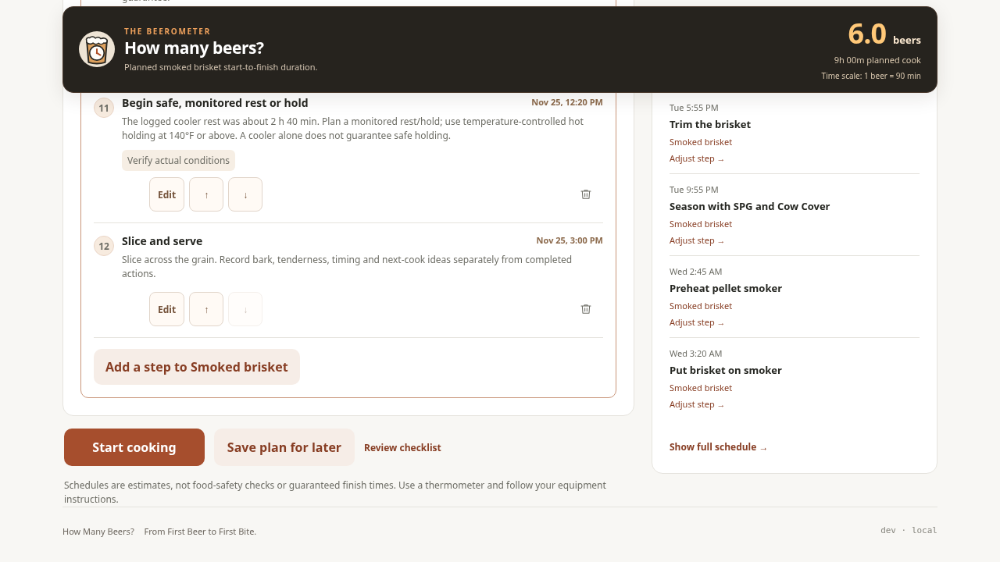
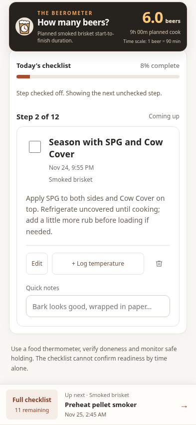
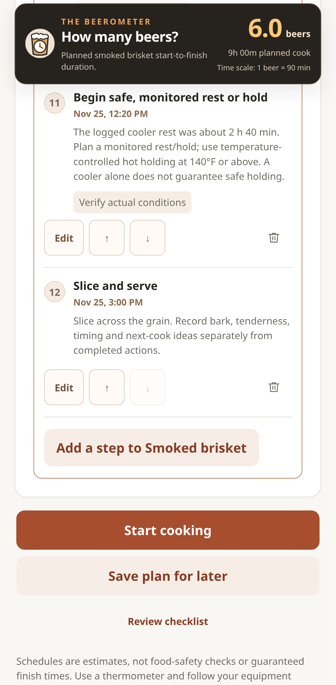
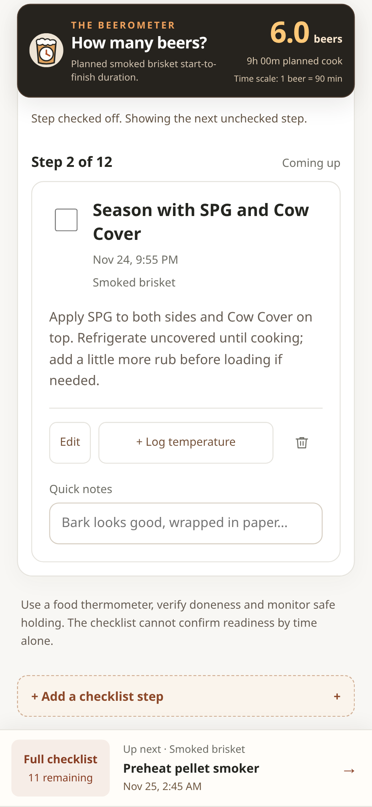

# How Many Beers?


**From First Beer to First Bite.**

Plan every dish. Time your dinner. Enjoy the cook.

Cooking dinner is easier when everything works toward the same finish line. **How Many Beers** helps you plan a meal, coordinate multiple dishes in one schedule, and follow a guided checklist when it's time to cook. Less juggling recipes and timelines. More enjoying the cook.

**[Launch How Many Beers](https://howmanybeers.app)** · [Dev preview for QA](https://dev.how-many-beers.pages.dev/) · [Share feedback or report a bug](https://github.com/Warconn/how-many-beers/issues)

## One dinner. One game plan.

1. **Set serving time.** Pick when you want to eat. Build your plan around dinner, not a pile of separate recipes.
2. **Add dishes.** Choose a starter cooking method or add your own instructions. Put brisket, brats, wings, turkey, or other dishes into the same cook.
3. **Adjust the plan.** See every dish together in the **Live Schedule**. Fine-tune steps, dates, estimated durations, and equipment notes without losing sight of the whole meal.
4. **Cook.** Follow the current step in **Cooking Mode**, preview what's next, or open the full checklist. Check off progress, add notes, and log temperature readings as you go.

## A look at the app

These desktop and mobile screenshots show the current dev workspace, including the prominent Beerometer. Dev changes receive final QA before promotion to production.

| Plan your dinner | Follow the cook |
| --- | --- |
|  |  |
|  |  |

## What works today

- **A meal with multiple dishes.** Add several dishes to one cook and see a combined chronological schedule.
- **Personal cooking templates.** Brisket with SPG/Cow Cover and staged smoker heat, brined oven turkey with advance thawing preparation, and covered beer-bath brats finished on the Blackstone. All seven built-in methods include editable preparation, cooking and relevant finishing/rest allowances. Brats split covered cooking from searing; condition checks still require verification. See [method notes](docs/personal-templates.md).
- **Starter recipes and your own instructions.** Start from built-in methods, paste recipe text, or import a `.txt` or `.md` file. Recipe preview fills in explicit durations from the text, including hours and ranges. Review or adjust estimates before adding; ranges visibly use the longer planning estimate and unknown times stay blank. Estimated durations remain editable directly on imported steps.
- **An adjustable cooking plan.** Edit dish steps, timing, durations, and planning notes. Changes appear in the shared schedule. Some duration changes move later timed steps in the same dish, but this is not a full automatic dependency or equipment optimizer.
- **Guided Cooking Mode.** Timed imported recipes show live step finishes and upcoming estimates as you make progress, while preserving the original plan and recorded starts. Work through the current step, preview the next, check the complete list, record temperatures and notes, and resume a cook in progress.
- **Save, finish, and repeat.** Save a plan for later, keep a cook in progress, and explicitly finish and archive completed cooks. Review history, repeat a past cook, or Cook Again. Exceptional recovery retains JSON backup/restore.
- **The Beerometer.** Measures the whole multi-dish cook, including advance prep, with estimated beers remaining during cooking, passive countdowns and uncertainty for overrunning heat; actual physical work governs remaining time, while duplicate projected/elapsed totals stay out of the main display.

**Timing is guidance, not a food-safety decision.** Estimated step times and recipe templates cannot confirm that food is cooked or held safely. Use actual checks and appropriate food-safety guidance.

### Saving and recovery

Production accounts support one saved active/planning cook, completed history and
retrieval on another device. In account-enabled builds, new guests can try planning
and cooking without persistent saves. Existing legacy browser records and recovery
mechanisms remain intact. Sign-in opens account cooks directly; the pre-1.0 Earlier
cooks migration UI has been removed.

Account edits save automatically. A compact header icon shows saved, saving or attention states, with accessible labels; failures offer retry/export. Keep the tab open when saving needs attention. Stale devices cannot silently overwrite newer account data. Offline files still prepare in the background after an online visit; there are no install/offline help panels or routine device-save labels. Browser data can be cleared or evicted, and exceptional recovery preserves backup tools. Private account cache requires verified sign-in after a cold reload; extended concurrent/offline synchronization remains future work. See [account saving and recovery](docs/account-cooks.md) and [existing offline behavior](docs/offline-reliability.md).

Empty plans ask **What do you want to cook?** with template and recipe-upload choices. Serving time stays editable; the schedule and cooking controls appear once there are steps.

## Run it locally

The project uses **Next.js, React, and TypeScript**. Use Node.js 22 or newer.

```bash
npm install
npm run dev
```

Open [http://localhost:3000](http://localhost:3000).

For focused iteration, run `npm run test:fast -- e2e/home-cleanup.spec.ts` (typecheck, unit tests and desktop/mobile browsers). Use the affected spec or account config. Before integration/release, run `npm run test:full` to include auth, account recovery, full regression and production-built offline checks. See [CI testing and timing evidence](docs/ci-testing.md).

To validate a change:

```bash
npm run typecheck
npm run test
npm run build
```

For browser regression tests, install Playwright’s Chromium and WebKit browsers and run:

```bash
npx playwright install chromium webkit
npm run test:e2e
npm run test:offline
npx playwright test --config playwright.auth.config.ts
npx playwright test --config playwright.accounts.config.ts
```

The build uses Next.js static export. The canonical production site is https://howmanybeers.app on Cloudflare. `dev` is the integration and QA branch; `main` is the stable release branch. GitHub Pages is a legacy deployment target. Set `DEPLOY_TARGET=cloudflare` for a domain-root build; the legacy build uses `/how-many-beers/`. See [agent/development guidance](AGENTS.md) for the branch and review workflow.

## Current work queue

The November 5 release combines [#98](https://github.com/Warconn/how-many-beers/pull/98)
(#21 visual consistency) with [#99](https://github.com/Warconn/how-many-beers/pull/99)
(#97 checklist-first cooking and the approved compact layout/Beerometer cleanup).
It extends release #96: #92, #84, #62/#85, #77 and #86 are completed work.
See [release notes and validation](docs/releases/2026-11-05.md); check the release PR
and Cloudflare status for deployment confirmation. Authentication, cloud saving and
cross-device history remain supported without schema changes.

Dev now includes **#109 serving-time-first planning** via #116, alongside the
#115 browser baseline repair. Choose when to eat first, then choose/review dishes.
**Start preparing** shows the day/date to begin; a later estimated-ready time is
shown when the target cannot be met. The target never moves automatically.
#101 physical cooking, #61 cancellation, #83 upcoming plans, #71 CI improvements
and #103's reviewed recipe controls remain delivered in dev. Personal reusable
recipe saving stays deferred.

**#117 is the next production-readiness bug:** manually fixing a template cooking
start/duration can over-delay checkpoints and serving. Default brisket/ribs serving
alignment works; shared-smoker coordination remains #3. This dev delivery is not a
production release. The owner approved #115/#116 integration and documentation;
future merges, production and hosted changes still need their own authorization.
Both November 5 dev migrations are confirmed applied/verified; do not reapply them.
See [dev delivery notes](docs/releases/2026-11-07-dev.md),
[the current queue](docs/work-queue.md) and
[planning rules and screenshots](docs/planning-readiness.md).
Notifications, URL import, social login and advanced synchronization stay deferred.

## Account foundation work

The #19/#20 delivery merged into dev adds verified email-code sign-in, owner-only transactional account saving and searchable completed history. The shared account dialog preserves cooking drafts. Google/Apple remain optional and unconfigured in dev. Accounts and cloud cooks default to disabled; enable only after applying the reviewed migrations and configuring the preview. The owner has verified production sign-in, cloud saving and cross-device history.

See [account setup and security gates](docs/account-foundation.md) and [account cooks setup, architecture and limits](docs/account-cooks.md). Run `bash scripts/test-account-security.sh` to test both migrations against isolated PostgreSQL with Docker. The account foundation is released and working in production. Follow [dev versus feature account setup](docs/dev-account-testing.md) to configure Preview variables and Supabase URLs, including automatic access for future `feat/*` previews.


Brisket planning now puts the recommended start first; open **Timing details** for
profile settings, buffers, evidence and limitations. Applying remains explicit.

## Documentation

- [Work queue](docs/work-queue.md): tonight’s priority and the prepared implementation order
- [Core cooking experience](docs/core-cook-experience.md): product flows and interaction principles
- [Cooking Mode](docs/cooking-mode.md): guided steps, progress, and finishing
- [Step timing](docs/step-timing.md): edits, duration handling, and schedule limitations
- [Saved plans](docs/saved-plans.md): browser-local persistence and resuming
- [Offline reliability](docs/offline-reliability.md): installation, offline use, recovery and regression tests
- [Brisket estimates](docs/brisket-estimates.md): method assumptions and uncertainty
- [GitHub Issues](https://github.com/Warconn/how-many-beers/issues): bugs, enhancements, release work, and planned capabilities

This repository is public, but no open-source license has been selected. Public visibility does not grant general permission to reuse the code.

Cooking Mode keeps the current action, a short instruction and its live duration/finish estimate in view. Condition checks say **Check when ready**. Open **Step details** for the full recipe, original plan, notes and activity. Open **Step details** to optionally record or correct meaningful physical starts; entering the session and checking prep do not start those phase clocks. Planning retains detailed timing controls.

Step editing opens a short form for name, instructions and duration. **More options**
keeps exact start times, equipment and target food temperatures available. Dish rows
use aligned Edit, Move and Remove controls; Add a step stays below the list.


Cooking Mode now uses one progress treatment and a single content column. Completed
cooks have one primary Finish action and checklist review, while Finish cook early
is available under Cook details & tools. The Beerometer retains the accepted design and calculations while hiding duplicate initial totals and zero elapsed.

Retained **Cancel cook** is implemented for review in #61: Home and Cooking Mode
provide a confirmation, completed history stays untouched, and account cancellation
waits for a server receipt. Install the additive dev migration before the capability-
gated account control appears. Guest trials remain temporary; legacy local canceled
records remain retained and backup-compatible. See [rollout details](docs/account-cooks.md).

Multiple upcoming account plans are implemented for review in #83, dependent on #61.
Home separates future meals from the single current cook. Each future plan saves
independently, and starting it is acknowledged atomically. Current cook/history and
upcoming plans have explicitly separate backup files; keep both for a full account
backup. Guest behavior and the accepted Cooking Mode/Beerometer stay unchanged.
See [upcoming cooks, compatibility and dev rollout](docs/upcoming-cooks.md).

## Approved meal planning (#103)

The approved recipe-first planner now lives at `/`, including on the ordinary dev
URL. Older `/recipe-first/` bookmarks redirect to `/`. Feature branches may still
use isolated review URLs, but reviewed dev work uses the normal entry point. See
[scope and test path](docs/recipe-first-preview.md). Personal recipe persistence
remains a later slice; no hosted schema change is required for this flow.

The approved planner shows short step instructions inline, expands longer
text on demand, and labels the combined schedule **Review Meal Plan**. Generic
review guidance and method-reference chrome are omitted; saved recipe/source data
and existing cooks remain intact.

Recipe review and prototype meal-planning rows share drag grips, upper-right Edit
and editor-contained Remove. The reusable action placement standard lives in
[the design system](docs/design-system.md#reusable-step-rows-and-actions-103-review).

Built-in cooking-start edits keep estimated checkpoints within their cooking
allowance, with rest/readiness following the estimated finish. Requested serving
time and recorded actuals stay intact. See [step timing](docs/step-timing.md).
