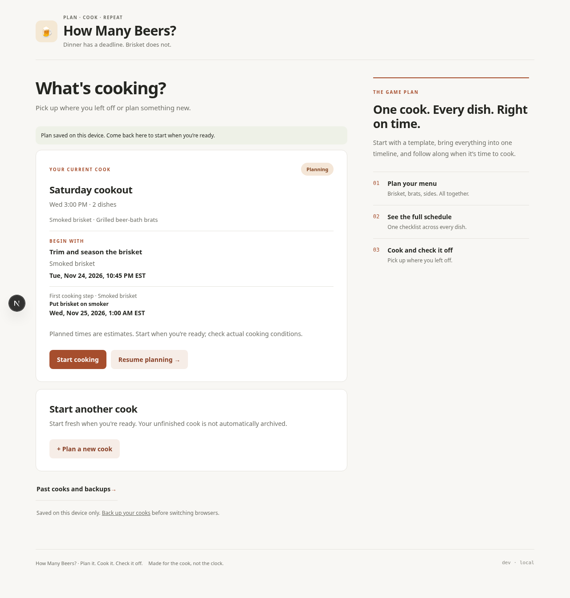
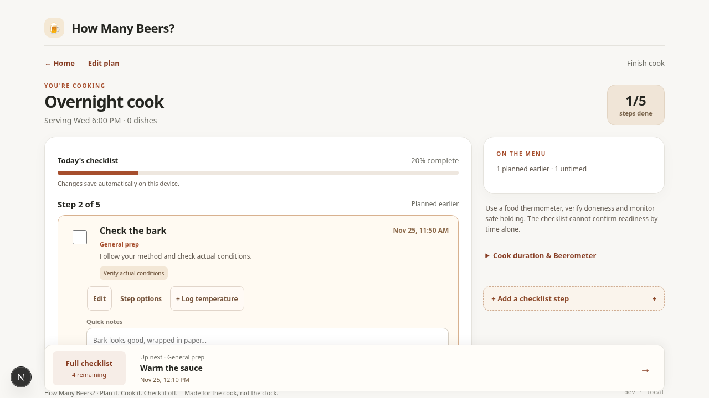
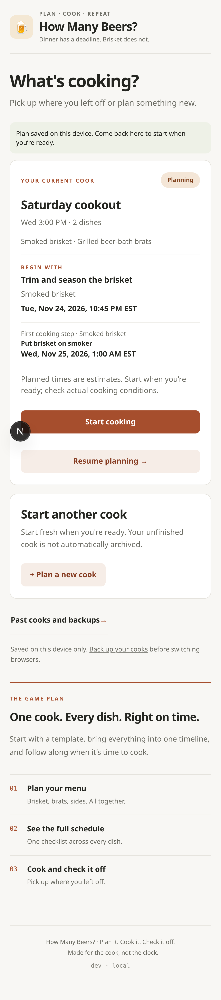
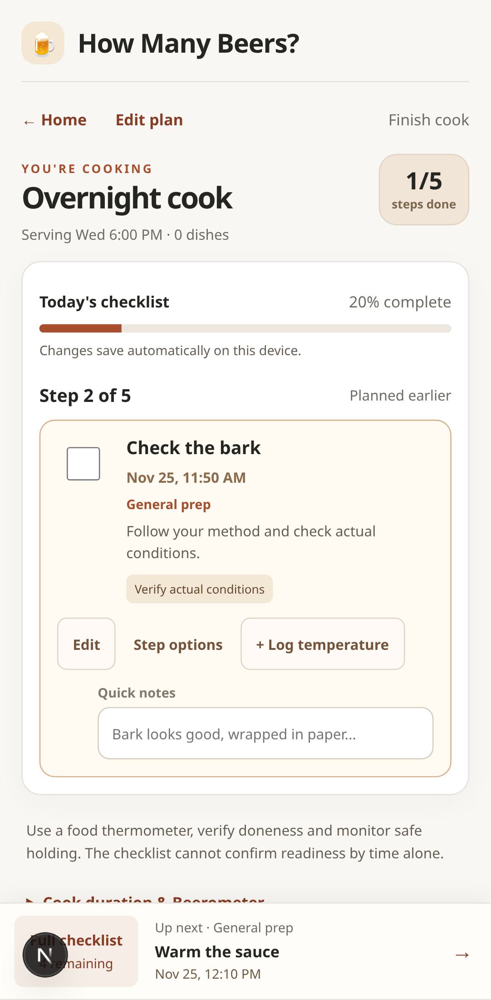

# How Many Beers?


**From First Beer to First Bite.**

Plan every dish. Time your dinner. Enjoy the cook.

Cooking dinner is easier when everything works toward the same finish line. **How Many Beers** helps you plan a meal, coordinate multiple dishes in one schedule, and follow a guided checklist when it's time to cook. Less juggling recipes and timelines. More enjoying the cook.

**[Launch How Many Beers](https://howmanybeers.app)** · [Share feedback or report a bug](https://github.com/Warconn/how-many-beers/issues)

## One dinner. One game plan.

1. **Set serving time.** Pick when you want to eat. Build your plan around dinner, not a pile of separate recipes.
2. **Add dishes.** Choose a starter cooking method or add your own instructions. Put brisket, brats, wings, turkey, or other dishes into the same cook.
3. **Adjust the plan.** See every dish together in the **Live Schedule**. Fine-tune steps, dates, estimated durations, and equipment notes without losing sight of the whole meal.
4. **Cook.** Follow the current step in **Cooking Mode**, preview what's next, or open the full checklist. Check off progress, add notes, and log temperature readings as you go.

## A look at the app

These are actual desktop and mobile screenshots from the project.

| Plan your dinner | Follow the cook |
| --- | --- |
|  |  |
|  |  |

## What works today

- **A meal with multiple dishes.** Add several dishes to one cook and see a combined chronological schedule.
- **Starter recipes and your own instructions.** Start from built-in methods, paste recipe text, or import a `.txt` or `.md` file. Text import is basic and may need review.
- **An adjustable cooking plan.** Edit dish steps, timing, durations, and planning notes. Changes appear in the shared schedule. Some duration changes move later timed steps in the same dish, but this is not a full automatic dependency or equipment optimizer.
- **Guided Cooking Mode.** Work through the current step, preview the next, check the complete list, record temperatures and notes, and resume a cook in progress.
- **Save, finish, and repeat.** Save a plan for later, keep a cook in progress, and explicitly finish and archive completed cooks. Review history, repeat a past cook, or export and restore a JSON backup.
- **The Beerometer.** A little personality alongside the practical cooking tools.

**Timing is guidance, not a food-safety decision.** Estimated step times and recipe templates cannot confirm that food is cooked or held safely. Use actual checks and appropriate food-safety guidance.

### Your cooks stay on this device

How Many Beers currently saves your active plan, progress, and cook history **in this browser's local storage**. You can refresh or return later in the same browser and site without an account.

There is **no automatic account sync or transfer between devices or browsers**. Clearing browser/site data, using a private browsing session, or changing to a different site origin can leave those saved cooks unavailable. Use the in-app **JSON backup/export** if you want a copy you can restore. Browser-local storage is convenient, but it is not a cloud backup.

### Offline cooking and recovery

After visiting online, wait for **Offline ready on this device** before relying on an offline reopen. You can keep using an existing cook, record progress and finish/save it without a connection. Install through the browser when offered, or use Safari's **Share → Add to Home Screen**. Installation does not create a cloud backup, and browser storage/cached files can still be cleared or evicted.

The app shows whether edits saved. If a write fails, keep the tab open, download a backup and retry. Unreadable saved data opens a protected recovery screen instead of being replaced. App updates wait for an explicit reload, with open drafts protected. Keep one cooking tab open; another tab's newer data must be reloaded before saving. See [offline reliability and recovery](docs/offline-reliability.md) for behavior and test coverage.

## Run it locally

The project uses **Next.js, React, and TypeScript**. Use Node.js 20 or newer.

```bash
npm install
npm run dev
```

Open [http://localhost:3000](http://localhost:3000).

To validate a change:

```bash
npm run typecheck
npm run test
npm run build
```

For browser regression tests, install Playwright's Chromium browser and run:

```bash
npx playwright install chromium webkit
npm run test:e2e
npm run test:offline
```

The build uses Next.js static export. The `dev` branch is the integration branch for previews; `main` is used for the GitHub Pages production deployment. See [agent/development guidance](AGENTS.md) for the branch and review workflow.

## Documentation

- [Work queue](docs/work-queue.md): tonight’s priority and the prepared implementation order
- [Core cooking experience](docs/core-cook-experience.md): product flows and interaction principles
- [Cooking Mode](docs/cooking-mode.md): guided steps, progress, and finishing
- [Step timing](docs/step-timing.md): edits, duration handling, and schedule limitations
- [Saved plans](docs/saved-plans.md): browser-local persistence and resuming
- [Offline reliability](docs/offline-reliability.md): installation, offline use, recovery and regression tests
- [Brisket estimates](docs/brisket-estimates.md): method assumptions and uncertainty
- [GitHub Issues](https://github.com/Warconn/how-many-beers/issues): bugs, enhancements, release work, and planned capabilities

This repository is public, but no open-source license has been selected. Public visibility does not grant general permission to reuse the code.
