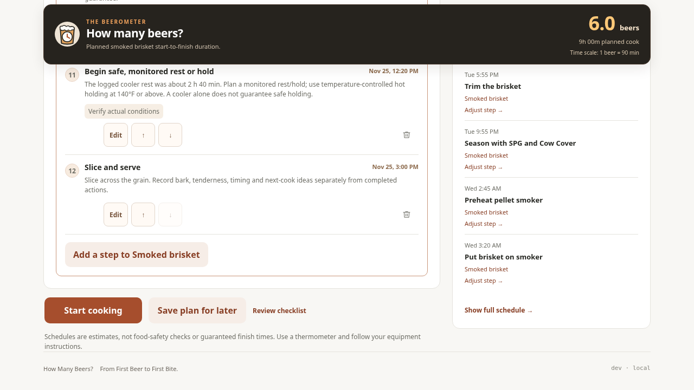
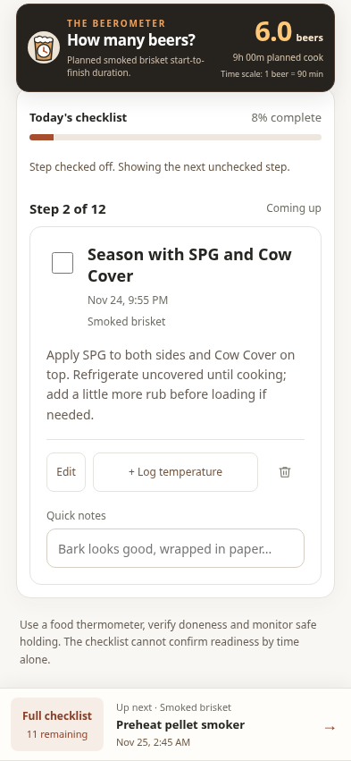
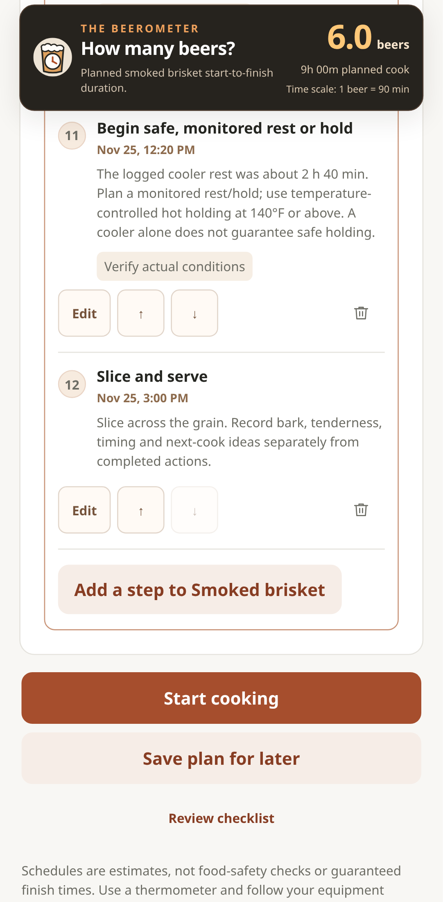
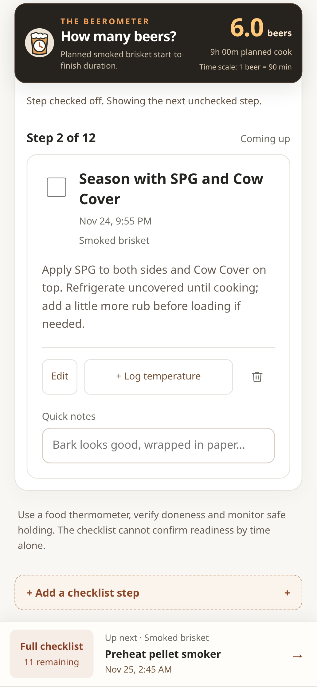

# How Many Beers?


**From First Beer to First Bite.**

### Dinner has a finish line. Your recipes should work together to reach it.

Cooking one dish is easy to plan. Cooking a whole meal means juggling prep, heat, resting time, and the question everyone eventually asks: *When are we eating?*

**How Many Beers** is a cooking companion that brings your dishes into **one meal plan**, works backward from when you want to serve, and helps you follow the next action when it's time to cook.

Brisket on the smoker, brats on the grill, turkey in the oven, or a few things going at once. Less mental math. More enjoying the cook.

**[Try How Many Beers](https://howmanybeers.app/)** · [Share feedback](https://github.com/Warconn/how-many-beers/issues)

## One meal. One game plan.

1. **Tell us when you're eating.** Choose a serving date and time. Start with dinner, then build the plan around it.
2. **Bring your recipes together.** Choose a starter method, pick from **My recipes**, or paste/upload your own instructions.
3. **Make it yours.** Adjust the steps, estimated times, equipment, and order. Review a combined meal schedule instead of bouncing between separate recipes.
4. **Follow the cook.** Cooking Mode keeps the next meal-wide action close. Independent activities can run together, and checked checkpoints keep accepting timestamped readings without stopping cooking.
5. **Remember the good ones.** Save meals for later, revisit past cooks, and reuse or refine your recipes for the next round.

## See it in action

| Plan the meal | Follow the cook |
| --- | --- |
|  |  |
|  |  |

*Screenshots are snapshots of the app in development. The interface continues to evolve.*

## Made for the way people actually cook

### 🕒 Plan around serving time

Pick when you want everyone at the table. How Many Beers combines the steps from multiple dishes into one chronological schedule, including prep, cooking, and rest where the recipe calls for them. Planning, live checklists and past-cook steps all display in time order.

Edit the plan as you go. Times are **estimates**, not promises. You stay in charge of when food is actually ready.

Cooking Mode keeps known-duration, unstarted dishes aligned to one estimated meal
finish, while preserving recorded starts and explicit fixed times.
Current template planning includes required refrigerator thawing and uses the
same activity forecast as Cooking. Opening Cooking before preparation is due
retains the future window; recording an actual start takes precedence.

### 📖 Bring your own recipes

Start with an editable cooking template or create a dish from pasted recipe instructions or a `.txt` / `.md` file. Review the steps and durations before adding them to your meal.

With **My recipes**, you can keep your favorite methods, update the original, or save a separate variation. A saved recipe stays independent from the specific meal you used it in.

### 🍺 Meet the Beerometer

*How many beers until dinner?*

The **Beerometer** turns the estimated time for your whole cook into a playful beer-sized countdown. It stays part of the experience as you move from planning into Cooking Mode, alongside the estimated serving time.

It's a little personality in a tool that's really about **time, timing, and getting dinner on the table**.

### ✅ Cook with a checklist, not a spreadsheet

When cooking starts, you get a focused next action and an accessible full checklist. Check off steps, record actual progress, log food or equipment temperatures, and add notes when something changes.

After you confirm doneness, the guide offers the next resting or holding action.
Recorded activity starts satisfy their checklist instruction, including after
the activity ends. The guide does not ask you to start an ended activity again.

A sticky next-action guide helps you keep your place. Head home, come back later, and continue the cook rather than starting over.

### 🔁 Save it, cook it, improve it

Keep multiple **upcoming plans** ready while working on one active cook. Finish a meal to preserve its history, including completed steps and recorded activity.

Browse **Past cooks**, see what happened, and choose **Cook again** to build on a previous meal. With a signed-in account, saved cooks and recipes can be retrieved across devices.

## Start with something familiar

The built-in starter methods cover practical favorites such as **smoked brisket, oven turkey, beer-bath brats, smoked-and-fried wings, and more**. They're starting points, not rigid instructions.

Want a different approach? Edit a method, import your own, or keep several variations in My recipes.

## What How Many Beers is (and isn't)

This is a **hands-on cooking companion**, not an autopilot for food safety or a guarantee that dinner will be ready at an exact minute.

- Cooking estimates help with planning; actual temperatures, doneness, and safe holding still require your judgment and appropriate food-safety guidance.
- You can add multiple dishes to one meal today. Advanced automatic cross-dish dependency scheduling, equipment conflict handling, and fully independent overlapping cooking phases are **still being designed**, not features to rely on yet.
- You can try the experience as a guest. Persistent, cross-device saved cooks and personal recipes use the account experience; guest work should not be treated as a permanent backup.

We're keeping the interface deliberately simple: **plan, cook, repeat**, with the detailed controls available when you need them.

## Have an idea?

How Many Beers grows out of actual cooks, the things that worked, the steps that got confusing, and the recipes worth making again.

[**Try the app**](https://howmanybeers.app/) · [**Suggest a feature or report a bug**](https://github.com/Warconn/how-many-beers/issues)

---

<details>
<summary><strong>For developers and contributors</strong></summary>

The app is built with Next.js, React, and TypeScript, with a mobile-first interface and account-backed saving.

To run locally with Node.js 22+:

```bash
npm install
npm run dev
```

Then visit [http://localhost:3000](http://localhost:3000).

- [Development and agent guidance](AGENTS.md)
- [Core cooking experience](docs/core-cook-experience.md)
- [Design system](docs/design-system.md)
- [Testing and release workflow](docs/ci-testing.md)
- [Current roadmap and work queue](docs/work-queue.md)
- [Account saving and recovery](docs/account-cooks.md)

Production: [howmanybeers.app](https://howmanybeers.app/)  
Dev preview: [dev.how-many-beers.pages.dev](https://dev.how-many-beers.pages.dev/)

</details>

This repository is publicly visible, but no open-source license has been selected. Public visibility does not grant permission to reuse the code.
