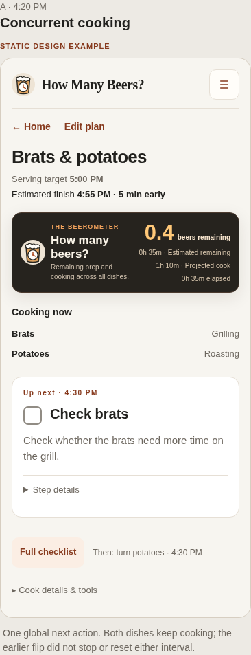
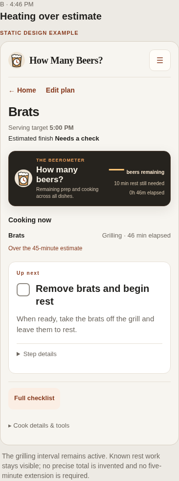
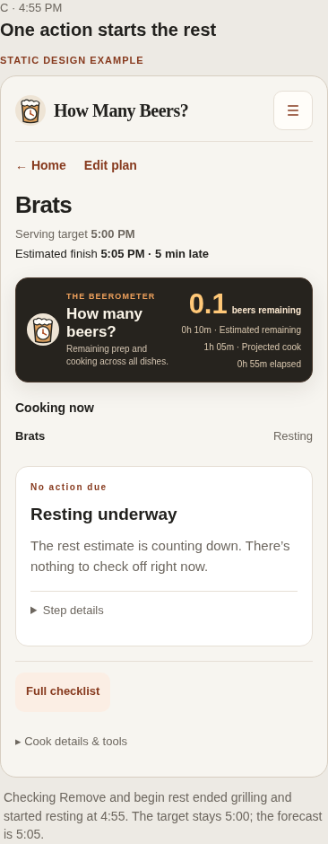
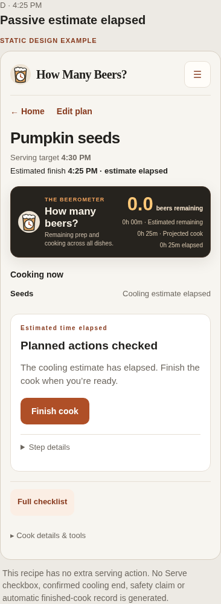

# #101 Cooking Mode: mobile design and forecast review

**Design proposal, November 5, 2026. No application/timing-engine implementation.**
The owner's latest seven clarifications and three examples govern this proposal.
Review the mobile experience and arithmetic before implementation is authorized.

[Portable mobile review sheet](mobile-review.html) · [Worked example data](examples.json)

The accepted #103/#108 UI stays the starting point: one clear instruction, a
checkbox, concise information and optional Step details. No extra timer tiles,
Start buttons, timestamp prompts, phase-classification forms or setup screens.
These screenshots are static design examples, not captures of implemented #101.

## Proposed mobile experience

The existing header separates **Serving target** from **Estimated finish**.
The Beerometer keeps its identity, layout and scale; only the values/status in its
existing slots change. Below it, a compact **Cooking now** list names concurrent
activities. Normal rows need no individual countdown. An overrunning activity adds
elapsed/over-estimate text. One **Up next** card contains the earliest actionable
item across the meal, with its checkbox. Full checklist and Step details retain
their accepted roles. Inspecting a dish is temporary; returning restores global
next-action priority without stopping any other dish.

| Review state | What the person sees | What the person does |
| --- | --- | --- |
| A: 4:20, concurrent cooking | Brats grilling, potatoes roasting; 35 min estimated remaining; finish 4:55 | Follow the next instruction and check it when performed |
| B: 4:46, grilling over estimate | Brats still grilling, 46 min elapsed; full finish uncertain; 10 min rest still needed | Remove/rest when actually done; optional remaining estimate stays in Step details |
| C: 4:55, actual remove-and-rest | Grilling ends and resting begins from the one checked action; 10 min remaining; finish 5:05 | Let the rest estimate count down; no new bookkeeping checkbox |
| D: passive cooling estimate elapsed | Cooling's 10-minute estimate has elapsed; 0 min estimated timed work | Finish cook when ready using the existing explicit finish action |

### One action can record a genuine transition

“Remove seeds and leave to cool” records the actual end of roasting and actual
start of cooling as one atomic, retry-safe user action. The phases remain distinct
internally. Do not add another checkbox to describe the same physical act.
If cooling/resting begins at a separate real moment, use the recipe's separate
physical action instead. An unrelated flip/checkpoint never ends cooking.

Start Cook records the session start. It does not create starts for every dish.
Each explicitly authored physical start action supplies its own actual timestamp.
Ordinary preparation/checklist completion never fabricates a physical start.

### Estimated passive time is not confirmed completion

Separate three facts: **estimated time left**, **performed checklist actions**,
and **explicitly finished cook / confirmed physical observations**.

A known passive cooling/rest estimate may reach zero as the clock passes. That
changes a derived estimate only. It does not create an end/Serve event, tick a
checkbox, assert safe doneness/storage temperature, or archive the cook. Do not
insert a Serve checkbox solely to exhaust that estimate. Genuine authored serving
or safety-check instructions remain available and require their own user action.
Condition-driven holds with unknown duration do not become finite passive timers.

When all actual actions are checked but passive time remains, the main card is a
quiet waiting state (“Cooling underway”), not a fabricated action to check off.
When that estimate elapses, show “Estimated cooling time elapsed” and the existing
Finish cook action. Finish cook early stays in existing secondary tools. Expiry
never triggers a confirmation dialog or finishes the session automatically.

### Overrun without mandatory extensions

Heat stays active until its explicit end action. At 46 minutes against a 45-minute
estimate, show **46 min elapsed · Over estimate**. Do not restart 45 minutes, force
five-minute extensions, or report zero for an unknown active heating remainder.

Recommended uncertain meter state: **— beers remaining**, with the existing
secondary line saying **10 min rest still needed**. Estimated finish says
**Needs a check**. This preserves known work without claiming a precise total.
For multiple dishes the known lower bound respects overlap and dependencies;
it is not a sum of every remaining dish/step. Exact unknown total remains unknown.

An optional remaining-time estimate is available in Step details, for example
“About 8 minutes remaining” recorded at 4:46. It anchors a forecast to that moment;
it does not change the physical start, imply confirmed doneness, or add a new
main-screen timer. Later actual events take precedence over that estimate.

### Corrections and action priority

Checking an action records now immediately. Correct actual time in Step details,
without interrupting the normal checklist. Append the correction, retain the prior
observation and recalculate affected future checkpoints, remaining work and the
full-meal ETA. Actual records for other dishes, and already recorded later actual
boundaries, are not moved to make the forecast fit. Correcting a phase start also
does not backdate the whole session start.

A newly past-due checkpoint becomes due; it is not automatically checked. Already
completed checkpoints retain their actual timestamps. Missed checks do not stop
other physical activities or prevent inspecting/acting on another dish. Equal-time
actions use a stable order and the existing next-action navigation; no new queue
management controls or reminder system are introduced.

## Worked timing examples

All clocks below are local to the cook. The 90-minute beer scale is unchanged.
These are design arithmetic, not results produced by the current application.
The serving target remains **5:00 PM** throughout worked examples 1–3 unless the owner
explicitly changes it. A later ETA must never silently replace that target.

### 1. Concurrent brats and potatoes; flip is only a checkpoint

These are illustrative #101 durations, not changes to the bundled template methods.
The session begins at 3:45 for preparation; this does not start either dish.
Assumptions: brats have 45 min grilling followed by 10 min passive rest; potatoes
have 40 min roasting and no further work. No resource conflict or extra fixed wait.
Future rest start is forecast until an actual remove-and-rest action occurs.

| Clock / event | Brat work still needed | Potato work still needed | Whole-meal remaining / ETA |
| --- | --- | --- | --- |
| 4:10, potatoes started; brats started at 4:00 | 35 min grill + 10 min rest | 40 min roast | 45 min → 4:55 |
| 4:15, flip brats checked | 30 min grill + 10 min rest | 35 min roast | 40 min → 4:55 |
| 4:20, no checkbox touched | 25 min grill + 10 min rest | 30 min roast | **35 min → 4:55** |

At 4:20 the remaining whole-dish paths overlap: max(25 + 10, 30) = 35 min.
It is not 65 min, and flipping does not stop/restart grilling. Without a rest
allowance in the recipe, this same example would be 30 min → 4:50; the example
above deliberately includes the later 10-minute rest so no work disappears.

### 2. Heating overrun followed by actual rest

This example isolates brats so there is no unrecorded potato end to assume.
The session and grilling begin at 4:00; the phone rest state continues this example.

| Clock / event | Heating state | Remaining / full-meal forecast |
| --- | --- | --- |
| 4:44 | Active, 44 min elapsed | 1 min grill + 10 min rest → 4:55 |
| 4:45, estimate expires | Still active, end unconfirmed | Heating remainder unknown; rest 10 min still required; exact ETA unavailable |
| 4:46, still on grill | Active, 46 min elapsed, over estimate | Same honest uncertainty; do not force an extension |
| 4:55, “Remove brats and begin rest” checked | Actual heat end 4:55; actual rest start 4:55 | **10 min → 5:05**, 5 min later than requested 5:00 |
| 5:00, no checkbox touched | Rest estimate active | 5 min → 5:05; target still 5:00 |
| 5:05 | Rest estimate elapsed | 0 min estimated timed work; no automatic physical confirmation or finished-cook record |

At exactly the unconfirmed heated deadline, do not show a misleading exact zero.
Elapsed passive estimates may reach zero; unknown active heating may not.

### 3. Correct a late-recorded grilling start

At 4:20, the recorded brat start is initially 4:12; actual potato start is 4:10.
Brat grilling = 45 min, rest = 10 min; potatoes = 40 min. The flip checkpoint is
+15 min and remains unchecked in this correction example.

| Derived value | Before correction | After changing brat start to 4:00 |
| --- | --- | --- |
| Brat elapsed | 8 min | 20 min |
| Brat grilling still needed | 37 min | 25 min |
| Brat path including rest | 47 min → 5:07 | 35 min → 4:55 |
| Flip due | 4:27 | 4:15, now due; remains unchecked |
| +30 min check due | 4:42 | 4:30 |
| Potato actual start / forecast end | 4:10 / 4:50 | **Unchanged: 4:10 / 4:50** |
| Full meal remaining / forecast end | 47 min / 5:07 | **35 min / 4:55** |
| Requested serving time | 5:00 | **Unchanged: 5:00** |

Keep the original recorded observation and append its correction. If a rest start
or another later physical boundary already has an actual timestamp, preserve it;
correcting the earlier start changes elapsed/derived values, not that later fact.

### 4. Cooling without a required Serve checkbox

Roast ends and 10 min cooling begins when “Remove seeds and leave to cool” is
checked at 4:15. This recipe has no genuine additional Serve action.

| Clock | Cooling estimate remaining | What is recorded / shown |
| --- | --- | --- |
| 4:20 | 5 min | Cooling continues; no new checkbox is required |
| 4:25 | 0 min | “Estimated cooling time elapsed”; no completion/end/Serve event is fabricated |
| 4:26 | 0 min | Cook remains open until the user explicitly finishes it |

The requested 4:30 serving target remains 4:30. Zero timed work is not a food
safety statement, proof that every possible action was done, or an archive action.

### Additional forecast checks before implementation approval

- A delayed actual brat start of 4:10 (45 + 10 min work) forecasts 5:05; target
  stays 5:00. This does not move the potato's actual start.
- Changing grilling's estimate from 45 to 55 min after a 4:00 actual start also
  forecasts 5:05, while preserving all actual timestamps and the serving target.
- Overnight brisket and a Sunday target use actual smoking/rest boundaries. Rapid
  prep/wrap check-offs do not manufacture elapsed smoking time. A wrap/check does
  not end smoking; removal does. Calendar idle gaps are not added as cook work.
- Returning after reload/offline uses the current clock and persisted observations,
  not a paused in-memory countdown. It must not duplicate starts/transitions.

## Requirements for a later implementation

Templates have explicit start/end/checkpoint relationships authored in advance.
One action may reference an ending interval and a starting interval. Passive
estimate expiry must be representable separately from actual completion. Imports
may suggest a structure in the existing recipe review; the user sees instructions,
times and ordinary editing, not phase classification or a new setup screen.
Ambiguous steps retain normal checklist behavior. Never derive real historical
starts/ends from titles, timer expiry, check counts or an imported guess. Legacy
cooks keep their current records/behavior unless deliberately adapted in a later,
reviewed compatibility path; no bulk conversion of stored sessions.

Checklist progress continues to describe actions performed, not physical doneness
or a fraction of elapsed phase time. Renaming/reordering/removing steps must not
silently create new physical semantics. Preserve explicit relationships by stable
IDs; ambiguous new mappings fall back to ordinary checklist behavior. Adding a
dish during a session updates the forecast but does not start that dish.

All projections (current action, upcoming actions, whole-meal remaining, ETA and
Beerometer) use one coherent model. Preserve ownership, guest policy, backups,
completed history and original plan. Compound action records and corrections need
an atomic, idempotent, append-only persistence design reviewed before database or
runtime changes. No schema or event implementation is approved by this document.

#109 owns serving-time-first planning, visible targets and pre-cook recalculation.
#101 owns live phase observations and runtime projections. Respect already defined
prerequisites/fixed anchors; do not bundle #3's full resource optimizer or #11's
notifications. Keep the accepted logo, Beerometer visual identity and #103 controls.

## Review points before coding

The seven owner clarifications are requirements. These are proposed presentations
for review, not new implementation approval:

1. Unknown total: keep the meter's unknown value, show known remaining work in its
   existing secondary line, and “Needs a check” beside the finish estimate.
2. After passive time elapses with no next action, show the existing Finish cook
   action without adding a Serve checkbox or an automatic completion event.
3. Keep elapsed/over-estimate text on the relevant Cooking now row, and optional
   remaining/time corrections inside Step details.

Review the four phone states and arithmetic first. Implementation requires a
separate explicit instruction; no engine, UI route, database, deployment or merge
is included in this design branch.
