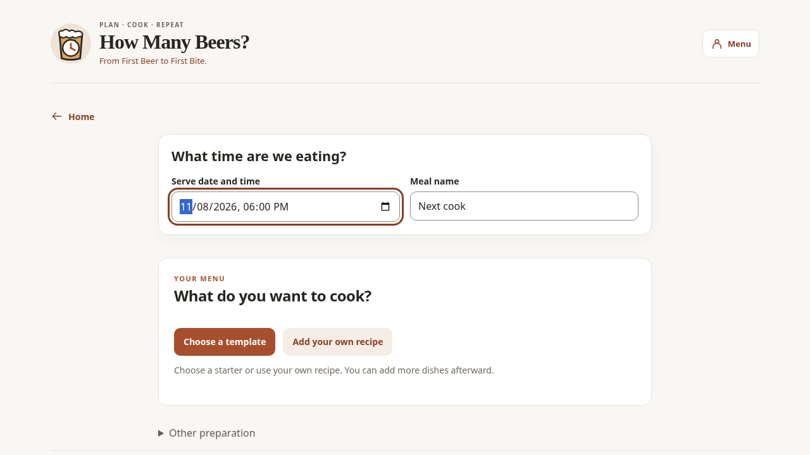
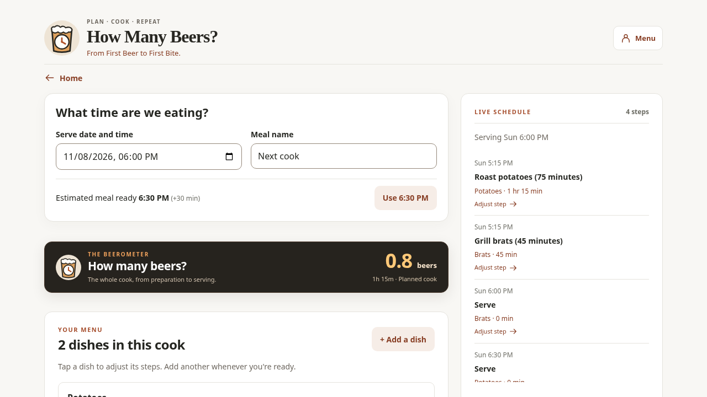
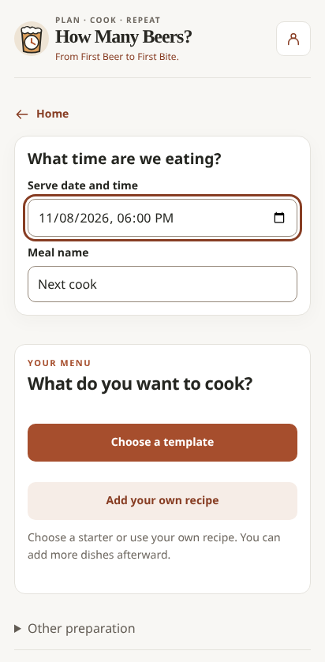
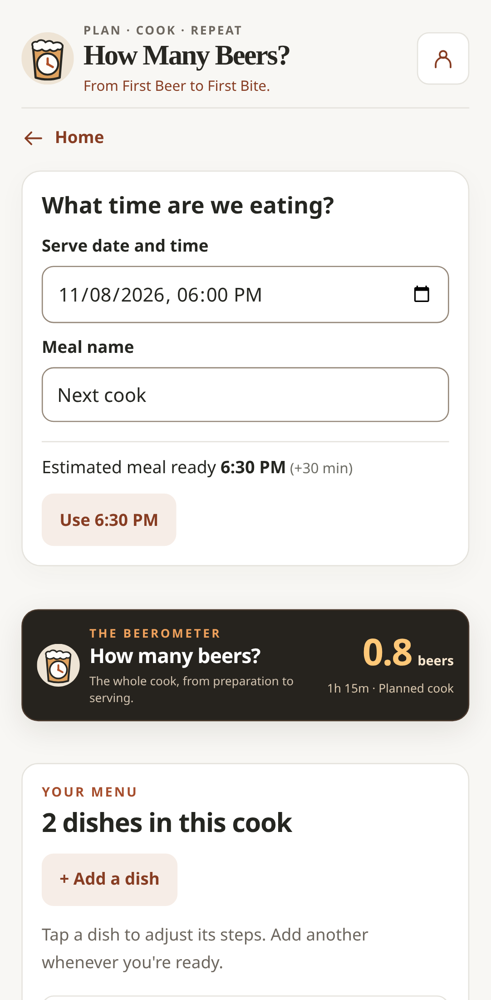

# #109: serving target and pre-cook readiness

The meal's requested serving date/time is the first planning control, before any
dish. It stays editable while choosing/reviewing recipes and after combining dishes.
Recipe review and drag/edit actions retain the accepted #103 design. Estimated meal
ready appears beside an inline positive target difference; a suggested target is an
explicit action, never an automatic change. There is no new setup wizard.

## Calculation boundary

`planningReadiness` is a pure display projection over the existing `cookTimeline`,
step durations and explicit recipe order. Independent dish paths overlap. A fully
specified sequential recipe starts no earlier than now and each preceding end.
Fixed anchors remain displayed at the user's time, with a named conflict if work
cannot reach them. Flexible starts reflow through existing scheduling helpers.
Authored template overlaps/spacing are retained, rather than serializing every
checkpoint. Unknown required durations/unscheduled work do not produce a guaranteed
finish. No calculation writes an inferred start, completion or target to storage.

The planning task display, combined preview, live schedule and planned Beerometer
consume the same projection. The Beerometer component and its live calculation are
unchanged. Existing active sessions/recorded activity bypass the projection entirely;
#101 continues owning physical starts/ends and running forecasts. Existing storage,
accounts, upcoming-plan promotion and completed snapshots are unchanged.

## Deterministic acceptance examples (November 8, UTC)

| Scenario | Expected result |
| --- | --- |
| At 16:00, potatoes75 + brats45, target18:00 | Starts16:45/17:15; ready18:00; window75min |
| Same meal at17:15 | Ready18:30; +30min; target18:00 until explicitly accepted |
| Turkey30prep+120roast+30rest at16:00 | Ready19:00; +60min; no past/fake actuals |
| Add independent sauce15 | Starts17:45; ready18:00 unchanged |
| Target moves18:00→18:45 | Flexible starts17:30/18:00; durations/fixed anchors retained |
| Preheat15 fixed17:20 + grill35 + rest10 | Starts17:20/17:35/18:10; ready18:20 |
| Preheat extends15→25 | Flexible starts16:50, ready18:00; fixed17:00, ready18:10 |
| Potato prep10→20, roast65 | Starts16:35/16:55; brats unchanged; ready18:00 |

Tests assert concrete ISO timestamps and visible values, not just component presence.
Additional coverage exercises reordering, insert/remove, reload, actual preservation,
account future plans without overwriting an active cook and meter coherence.

## Explicit limits deferred to #3

These illustrative recipes have known durations and independent available resources.
This does not discover cross-dish prerequisites, queue equipment, model shared cook
capacity/temperature compatibility, calibrate food doneness or optimize arbitrary
parallel steps. Existing equipment/timing warnings remain. A manually ordered recipe
is the user's order; the app does not infer that it is a safe dependency graph.
Unknown durations remain unknown. Actual food checks are still required.

No new Supabase migration. Both November 5 migrations are owner-confirmed verified
in dev. PR #106's older queue is superseded, not merged. No automatic merges or
production promotion are authorized.

## Reviewed application screenshots

| Initial planner | Late meal |
| --- | --- |
|  |  |
|  |  |

Captured from the running application with a fixed clock. The target stays ahead
of the dish choices; lateness is inline, and the existing meter remains beers-first.
WebKit screenshots are also produced by the full CI run in the review artifact.
